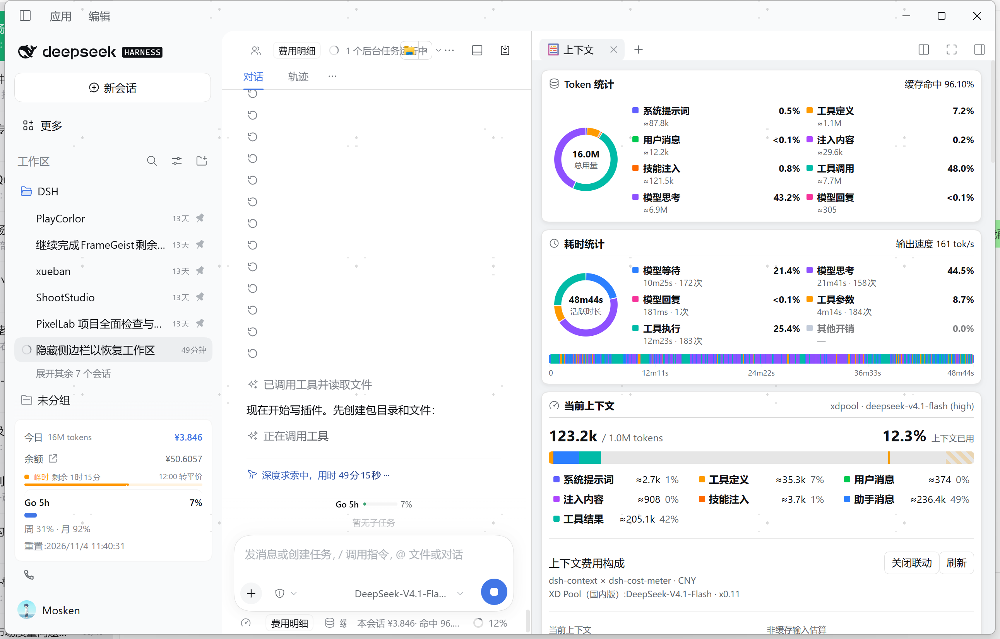
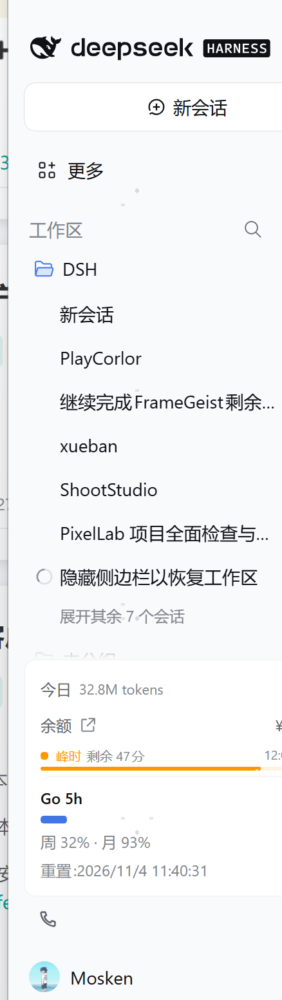
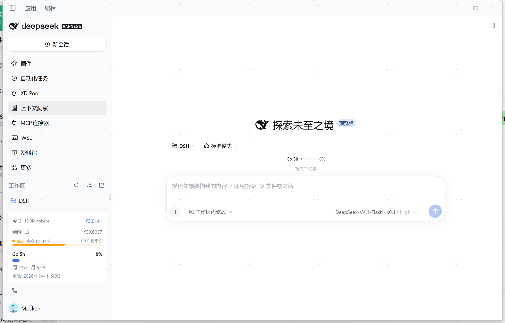

# dsh-panel-fold

**Fold the DSH sidebar's global panel icons into the More menu — give your workspace and session list its vertical space back.**

[中文说明](#中文) · MIT · a [DeepSeek Harness](https://github.com/deepseek-ai) web client plugin

---

DSH's left sidebar devotes a fixed block near the top to the *global panel* launchers — Plugins, Automated tasks, XD Pool, Context insights, MCP connectors, WSL, Library, and so on. Every plugin that registers a panel adds one more 36px row there. With a handful of plugins installed, that block alone eats seven or eight rows, and the workspace / session list underneath gets squeezed into a narrow strip.

This plugin folds those rows into the single **More** button that already sits at the bottom of that block. Panels stay one click away; the list above your sessions does not.

| Before | After |
| --- | --- |
|  |  |

Both screenshots are of the same window with the same plugins enabled — the only difference is the fold.

> Verified on DSH `0.2.1-rc.2` (desktop profile, Windows). The fold survives `Ctrl+R`, and folded-vs-expanded round-trips in place without a reload.

## What you get

- **One row instead of eight.** The panel block collapses to `⋯ More`. The workspace list directly below gains roughly `7 × 36px` of height.
- **Nothing becomes unreachable.** Every panel is still in the More menu, and opening one behaves exactly as before (`selectPanel`, current selection preserved). `plugins` is untouched by design — it is the row ui-sidebar itself refuses to unpin.
- **A one-line toggle.** The last row of the More menu is `Show global panel icons` / `Fold global panel icons into More`. Click it and the rows come straight back, no reload, no restart.
- **The choice sticks.** Stored in `localStorage` under `dsh-panel-fold:mode` (`collapsed` | `expanded`), so it survives refresh, restart, and plugin reload.
- **Folded by default.** Installing the plugin is the opt-in.



## Install

Not on npm yet — install straight from GitHub:

```sh
dsh plugin --profile <your-profile> add github:meihuaanying/dsh-panel-fold
```

Or from a local checkout:

```sh
dsh plugin --profile <your-profile> add /path/to/dsh-panel-fold
```

Then reload the web client. The fold applies immediately; the toggle appears under the sidebar's More menu.

> Already installed an older copy under a different name? Remove it first (`dsh plugin --profile <p> remove <old-name>`) so the profile does not keep a dangling link to a renamed folder.

## How it works

No patching of ui-sidebar, and no dependency on its hashed CSS class names (those change between releases):

1. The web client half watches the DOM with a `MutationObserver` and marks the panel-list `<nav>` — matched first by its `aria-label` (`全局面板` / `Global panels`, i.e. ui-sidebar's `t("panels.label")`), falling back to the structural signal *"a `<nav>` that contains a `button[aria-haspopup="menu"]` and at least two direct child buttons"*.
2. One CSS rule hangs off a class on `<html>`:

   ```css
   html.dsh-panel-fold-collapsed nav[data-dsh-panel-fold-nav] > *:not(:last-child) {
     display: none !important;
   }
   ```

   The last child of that `<nav>` is the More button, so only it remains.
3. The toggle row registers into the `sidebar.panellist.actions` slot, which ui-sidebar renders inside the More menu.

### Why not the built-in unpin mechanism?

ui-sidebar does have a "pin / unpin panel" mechanism (`setPinned`), and unpinning a panel removes its row while keeping it in the More menu. But `setPinned` is only reachable through the `sidebar.panellist.actions` owner props, and that slot only mounts *while the More menu is open* — there is no way to apply a pin state at startup. The CSS route needs no such hook, and it is what lets the plugin honour a persisted preference on first paint.

## Reversibility

- **Temporary:** sidebar `More` → `Show global panel icons`. Instant.
- **Permanent:** disable or uninstall `dsh-panel-fold`. The `<style>` tag and the `<html>` class go with it, leaving the sidebar exactly as shipped.
- **Disable without uninstalling:** append to your user patch layer:

  ```yaml
  - id: dsh-panel-fold
    disabled: true
  ```

## Files

| File | Purpose |
| --- | --- |
| `lib/client.js` | The whole feature: style injection, `<nav>` marking, More-menu toggle row |
| `lib/index.js` | Host-side stub, exists only to carry the bundle patch row |
| `cordis.patch.yml` | Bundle patch inserting the `dsh-panel-fold` row |
| `test/manifest.test.mjs` | Checks the manifest, patch, and client entry agree |

## Related work

Two other plugins touch the same block. Both are stable, MIT, and worth a look if you want more than a fold:

- [`ACGsu/dsh-sidebar-panel-fold`](https://github.com/ACGsu/dsh-sidebar-panel-fold) — **the closest neighbour.** It adds its own "collapse panels" row above the list; collapsing turns the whole block into a single summary row (active panel icon + name) that opens a popover listing every panel, and the state persists through DSH's host settings channel rather than `localStorage`. If you would rather have a dedicated summary row with the active panel's name on it, use that one.
- [`LoktLin/dsh-sidebar-tidy`](https://github.com/LoktLin/dsh-sidebar-tidy) — a much broader take: it hides the brand row, the new-session button, the panel block *and* the footer settings behind one "exit minimal mode" button, and adds workspace colour blocks. If you want the whole sidebar stripped down, use that.

`dsh-panel-fold` deliberately takes the smallest possible slice: it adds **no new row** — it reuses the More button ui-sidebar already renders at the bottom of the block — it changes nothing else in the sidebar, and it keeps the client half under 7 KB with no host-side code at all.

## License

MIT

---

## 中文

**把左侧栏那排「全局面板」图标收进『更多』，把纵向空间还给工作区和会话列表。**

DSH 左侧栏顶部有一块固定的「全局面板」入口区 —— 插件、自动化任务、XD Pool、上下文洞察、MCP 连接器、WSL、资料馆……每装一个会注册面板的插件，这里就多一行 36px。装上几个插件后，这块自己能占七八行，下面的工作区 / 会话列表被挤成窄窄一条。

这个插件把那一排收进块底本来就有的 **『更多』** 按钮里。面板仍然一键可达，你的会话列表回来了。

### 你会得到

- **一行代替八行。** 面板块收成一个 `⋯ 更多`，下面的工作区列表多出约 `7 × 36px`。
- **没有任何东西变得不可达。** 所有面板都在『更多』菜单里，点开行为完全不变（`selectPanel`，当前选中项保留）。`plugins` 一行按设计不动 —— ui-sidebar 自己就不允许取消固定它。
- **一行开关。** 『更多』菜单最后一行是「显示全局面板图标 / 收起全局面板图标（只留『更多』）」，点一下立刻来回切，不用刷新、不用重启。
- **选择会被记住。** 存在 `localStorage` 的 `dsh-panel-fold:mode`（`collapsed` | `expanded`），刷新、重启、插件重载都保持。
- **默认折叠。** 装上它本身就是你的选择。

### 安装

还没上 npm，直接从 GitHub 装：

```sh
dsh plugin --profile <你的 profile> add github:meihuaanying/dsh-panel-fold
```

本地目录安装：

```sh
dsh plugin --profile <你的 profile> add /path/to/dsh-panel-fold
```

然后刷新 web 客户端。折叠立即生效，开关在侧栏『更多』菜单里。

> 之前装过改名前的老版本？先 `dsh plugin --profile <p> remove <旧包名>`，否则 profile 会留下指向已改名目录的断链。

### 实现方式

不改 ui-sidebar 一行代码，也不依赖它的哈希类名（那些版本间会变）：

1. web 端用 `MutationObserver` 找到面板列表 `<nav>` 并打标记 —— 优先按 `aria-label` 精确匹配（`全局面板` / `Global panels`，即 ui-sidebar 的 `t("panels.label")`），文案若变化则退回结构判据「`<nav>` 里含 `button[aria-haspopup="menu"]` 且至少有两个直接子按钮」。
2. 一条 CSS 规则挂在 `<html>` 的类上：

   ```css
   html.dsh-panel-fold-collapsed nav[data-dsh-panel-fold-nav] > *:not(:last-child) {
     display: none !important;
   }
   ```

   那个 `<nav>` 的最后一个子元素就是『更多』按钮，所以只剩它。
3. 开关行注册进 `sidebar.panellist.actions` 槽，ui-sidebar 会把它渲染在『更多』菜单里。

### 为什么不用内置的「取消固定」？

ui-sidebar 确实有「固定 / 取消固定面板」机制（`setPinned`），取消固定后面板行会从边栏消失、但仍留在『更多』菜单里。但 `setPinned` 只能通过 `sidebar.panellist.actions` 的 owner props 拿到，而那个槽**只在『更多』菜单展开时挂载** —— 启动时没有任何钩子能应用一个固定状态。CSS 路线不需要这个钩子，这也是它能首帧就兑现已保存偏好的原因。

### 恢复

- **临时**：侧栏『更多』→「显示全局面板图标」。立刻生效。
- **彻底**：停用或卸载 `dsh-panel-fold`。`<style>` 标签和 `<html>` 上的类一起消失，侧边栏回到出厂样子。
- **只停用不卸载**：在自己补丁层追加

  ```yaml
  - id: dsh-panel-fold
    disabled: true
  ```

### 与类似项目的关系

还有两个插件动的是同一块，都是 MIT、都在维护，想多要一点就看它们：

- [`ACGsu/dsh-sidebar-panel-fold`](https://github.com/ACGsu/dsh-sidebar-panel-fold) —— **最接近的一个。** 它在面板列表上方**自己加一行**「收起面板」；收起后整块变成一行摘要（当前面板图标 + 名字），点这一行弹浮层列出全部面板；状态存在 DSH 的 Host 设置通道里而不是 `localStorage`。你想要「一行摘要 + 当前面板名」那种形态，用那个。
- [`LoktLin/dsh-sidebar-tidy`](https://github.com/LoktLin/dsh-sidebar-tidy) —— 更激进：把品牌行、新会话按钮、面板块、底部设置全部收进一个「退出极简」按钮，还给工作区加彩色缩写块。你要的是「整个侧栏极简」，用那个。

`dsh-panel-fold` 刻意只切最小的那一块：**不新增任何一行**（复用 ui-sidebar 本来就在块底渲染的『更多』按钮），侧栏其它地方一律不动，客户端半边不到 7 KB、完全没有 Host 侧代码。

### 许可

MIT
